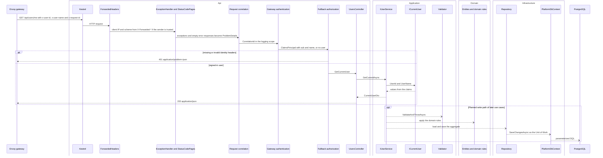
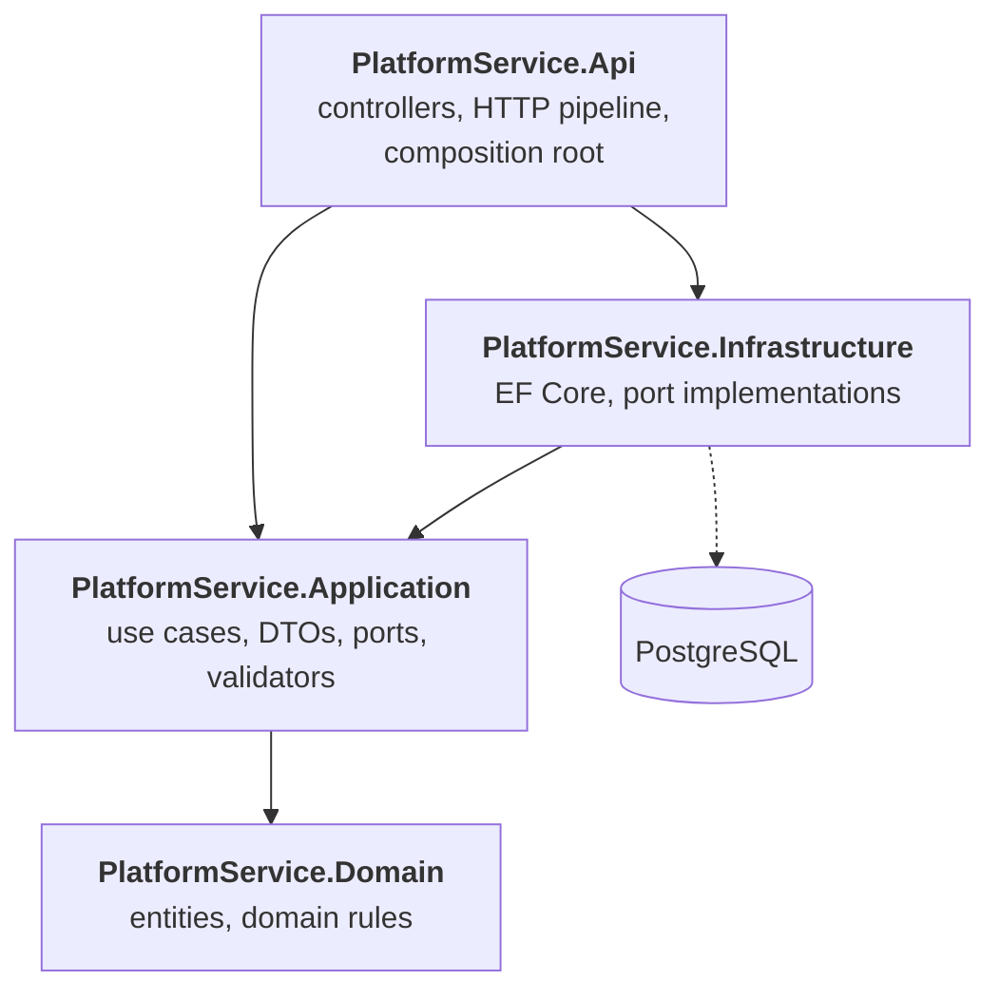

# platform-service

ASP.NET Core service of the online chess platform. It owns the users and every feature that is not real-time, which means game history now and friends and Élő ratings later. Live games are handled by `game-service` and the AI opponent by `engine-service`.

The service runs behind the Envoy gateway of the `infra` repo, as decided in ADR-3 and ADR-4. The gateway terminates TLS, validates the JWT and passes the user on in the `x-user-id` and `x-user-name` headers. The data is stored in PostgreSQL 18 through EF Core and Npgsql, as decided in ADR-5.

> This is a skeleton that shows the path of a request from the gateway to the database. The only feature endpoint is `GET /api/users/me`, and there are no entities or migrations yet.

## Prerequisites

- [.NET 10 SDK](https://dotnet.microsoft.com/download/dotnet/10.0)
- Docker for the local PostgreSQL `postgres:18-alpine` and for building the image

## Configuration

Settings come from `appsettings.json` and environment variables, where every `:` of a key becomes `__`. Required settings have no built-in defaults. If one is missing, the service stops at startup with an error that names it. Secrets never go into the repo, so locally use `dotnet user-secrets`.

| Setting | Environment variable | Required | Description |
|---|---|---|---|
| `ConnectionStrings:Platform` | `ConnectionStrings__Platform` | yes | Npgsql connection string of the service's own database |
| `ForwardedHeaders:KnownNetworks` | `ForwardedHeaders__KnownNetworks__0`, `__1` and so on | yes, set in `appsettings.json` | CIDR ranges that may send `X-Forwarded-For` and `X-Forwarded-Proto`, which is where the gateway connects from. `appsettings.json` lists the private ranges `10.0.0.0/8`, `172.16.0.0/12` and `192.168.0.0/16`. Environment variables override the entries by index, and entries with a higher index stay. |
| `ASPNETCORE_ENVIRONMENT` | | no | `Development` turns on OpenAPI and Scalar, plain text logs and exception details in 500 responses. Every other environment logs JSON. |

The service is reachable only through the gateway, so it has no HTTPS redirection, HSTS, CORS or rate limiting.

## Running locally

Start PostgreSQL. The network is only needed to run the Docker image as described under [Docker](#docker).

```bash
docker network create platform-dev
docker run -d --name platform-postgres --network platform-dev -p 5432:5432 \
  -e POSTGRES_USER=platform -e POSTGRES_PASSWORD=platform -e POSTGRES_DB=platform \
  postgres:18-alpine
```

Set the connection string once, then run the service on http://localhost:5080. Port 8080 is left for the gateway, because the dev proxy of the frontend expects it there.

```bash
dotnet user-secrets set "ConnectionStrings:Platform" \
  "Host=localhost;Port=5432;Database=platform;Username=platform;Password=platform" \
  --project src/PlatformService.Api
dotnet run --project src/PlatformService.Api
```

There is no gateway locally, so send the identity headers yourself. In Windows PowerShell use `curl.exe`.

```bash
curl -i http://localhost:5080/api/users/me \
  -H "x-user-id: 0193c2b4-7d3e-7c2a-9f1e-3b5a6c7d8e9f" \
  -H "x-user-name: alice"
# 200 {"id":"0193c2b4-7d3e-7c2a-9f1e-3b5a6c7d8e9f","userName":"alice"}

curl -i http://localhost:5080/api/users/me
# 401 application/problem+json
```

In Development the API reference is at http://localhost:5080/scalar. Its authentication panel has a field for both headers.

## Endpoints

| Method | Path | Access | Response |
|---|---|---|---|
| `GET` | `/api/users/me` | signed-in user | `200` with `id` and `userName`, or a `401` ProblemDetails. The frontend uses it to learn who is signed in, because the access token is in an HttpOnly cookie. |
| `GET` | `/health/live` | anonymous | `200` while the process runs. It checks no dependencies. |
| `GET` | `/health/ready` | anonymous | `200` if the database is reachable and `503` if not |
| `GET` | `/openapi/v1.json` | anonymous, only in Development | OpenAPI document |
| `GET` | `/scalar` | anonymous, only in Development | Scalar API reference |

Every endpoint requires a signed-in user unless it allows anonymous access, like `/api/*` at the gateway. `/health/*` is not under `/api`, so the gateway does not expose it.

Errors are [RFC 9457](https://www.rfc-editor.org/rfc/rfc9457) ProblemDetails in `application/problem+json` with a `traceId` and a `correlationId`. The `correlationId` is the gateway's `x-request-id`, or the server's own request id if the header is missing. The logs carry the same value as `CorrelationId`. Error messages are always in English, whatever the culture of the server.

| Cause | Status |
|---|---|
| `NotFoundException` | 404 |
| `ConflictException` | 409 |
| `ForbiddenException` or a policy that denies access | 403 |
| FluentValidation `ValidationException` | 400 with `errors` grouped by camelCase property |
| Malformed JSON or a wrong type in the request | 400 from `ApiController` |
| Missing or invalid identity headers | 401 |
| Anything else | 500 without details outside Development |

## Request flow

This is the middleware order of [`Program.cs`](src/PlatformService.Api/Program.cs). The planned part shows the write path of later use cases and is not implemented yet.



`ICurrentUser` is a port of the Application. The Api implements it from the `HttpContext`, which the Application never sees.

## Layers

Clean Architecture in four projects. The arrows are project references, so the compiler checks the dependency rule.



- **Domain** references nothing and has no NuGet packages.
- **Application** depends on neither ASP.NET Core nor EF Core. It defines the ports, such as `ICurrentUser` now and the repositories later, and the outer layers implement them.
- **Infrastructure** implements the persistence ports with EF Core.
- **Api** wires everything together. `Program.cs` calls `AddApplication`, `AddInfrastructure` and `AddPresentation`, then sets up the middleware.

## Tests

```bash
dotnet test
```

The tests use xUnit v3 on Microsoft Testing Platform, which `global.json` selects. The Test Explorer of Visual Studio finds them as well.

- `tests/PlatformService.UnitTests` tests the Application logic with hand-written fakes.
- `tests/PlatformService.IntegrationTests` runs the whole app in memory with `WebApplicationFactory<Program>` and a test connection string. It covers authentication, health and the mapping of exceptions to ProblemDetails, where a controller that exists only in the tests throws each mapped exception. No database is needed.

## Docker

```bash
# Image for the local platform
docker build -t platform-service .

# Image for both amd64 and arm64
docker buildx build --platform linux/amd64,linux/arm64 -t platform-service .

# Run it next to the local PostgreSQL from Running locally
docker run --rm --network platform-dev -p 8081:8080 \
  -e "ConnectionStrings__Platform=Host=platform-postgres;Database=platform;Username=platform;Password=platform;GSS Encryption Mode=Disable" \
  platform-service
curl -i http://localhost:8081/health/live
```

- The runtime image is `aspnet:10.0-noble-chiseled`. It runs as a non-root user and listens on port 8080.
- The chiseled image has no shell or curl, so it has no `HEALTHCHECK`. The infra side has to call `/health/live` and `/health/ready` from outside, for example with the active health checking of Envoy.
- The image has no Kerberos libraries. Npgsql tries GSS encryption by default and then writes `Cannot load library libgssapi_krb5.so.2` to stderr. The connection still works, and `GSS Encryption Mode=Disable` in the connection string removes the message.
- The image has no ICU or time zone data, so .NET runs in invariant globalization mode. Timestamps are in UTC anyway.
