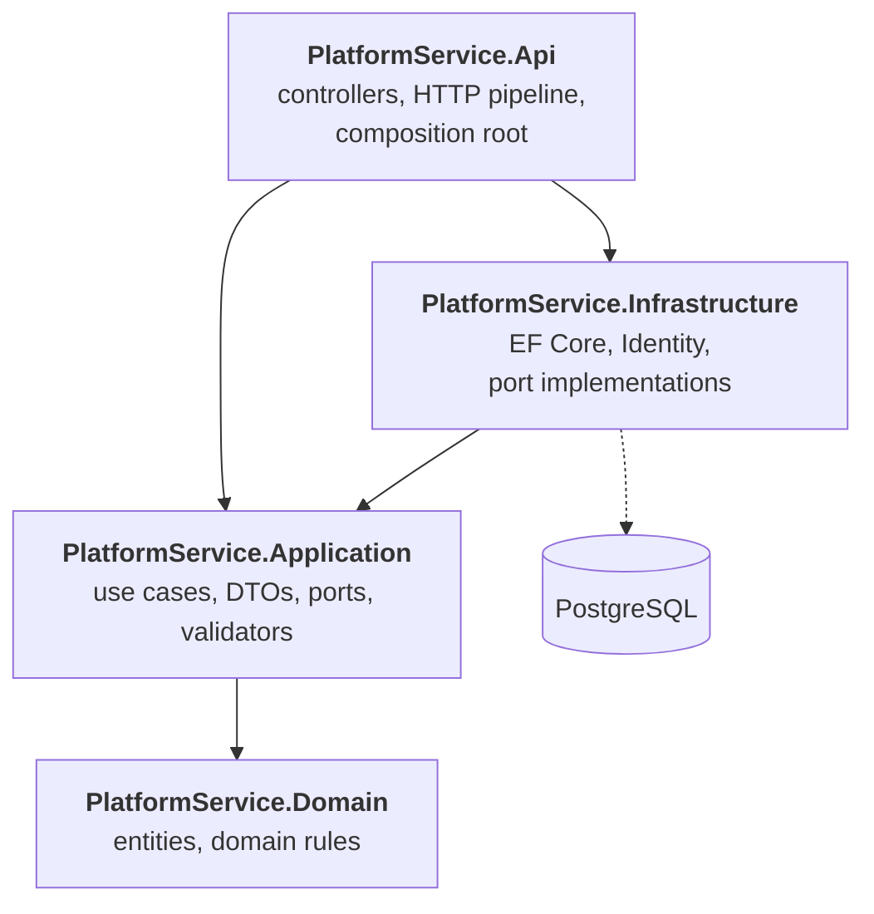
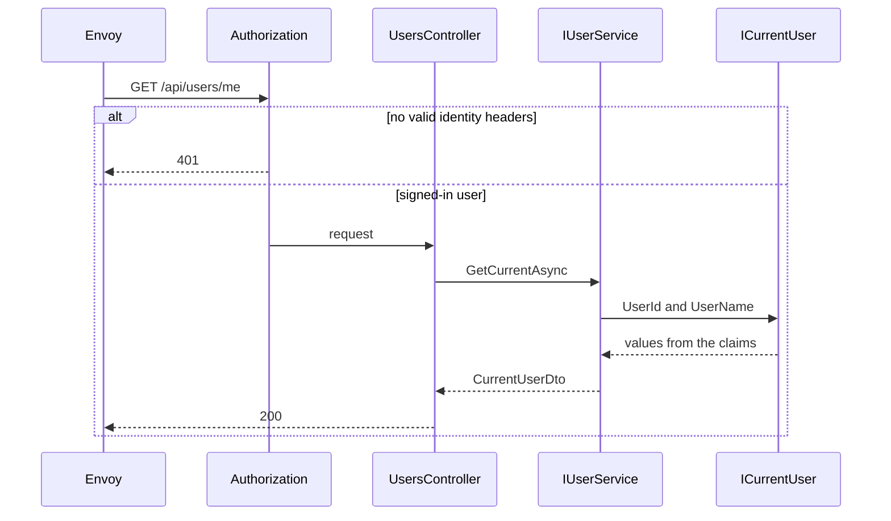
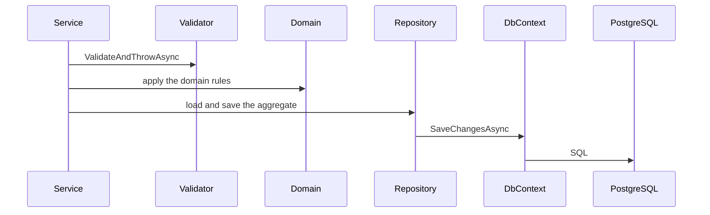

# platform-service architecture

The diagrams of the service at the component level of the C4 model.

## Layers

The arrows are project references, so the compiler checks the dependency rule of [PS-ADR-1](adr/clean-architecture.md).

## Middleware

The middleware of [`Program.cs`](../src/PlatformService.Api/Program.cs) in the order that [PS-ADR-3](adr/request-pipeline.md) decides.

## Reading the current user

How `GET /api/users/me` of [PS-ADR-2](adr/http-api.md) passes the layers, with the authentication of [PS-ADR-4](adr/gateway-authentication.md).

## Planned write path

The path of the later use cases that change data. It is not implemented yet.

