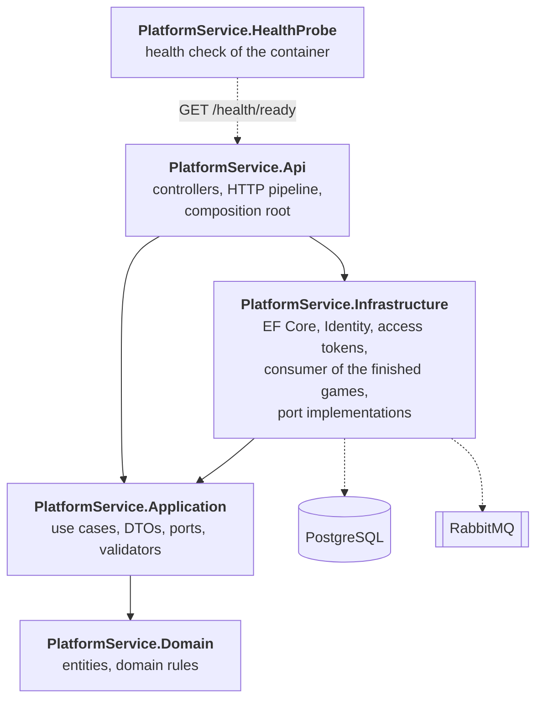
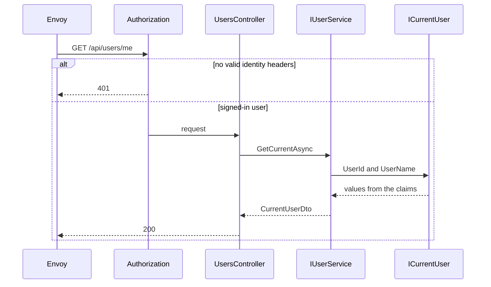
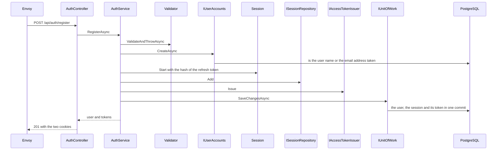
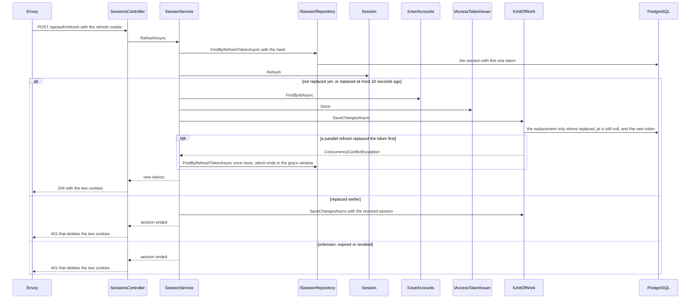
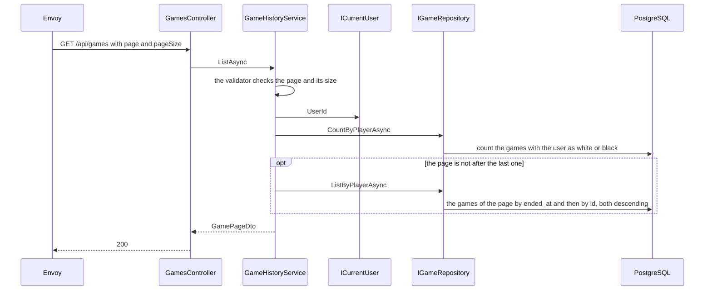
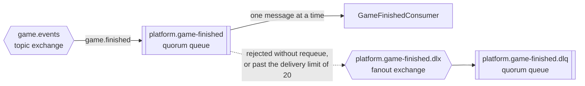
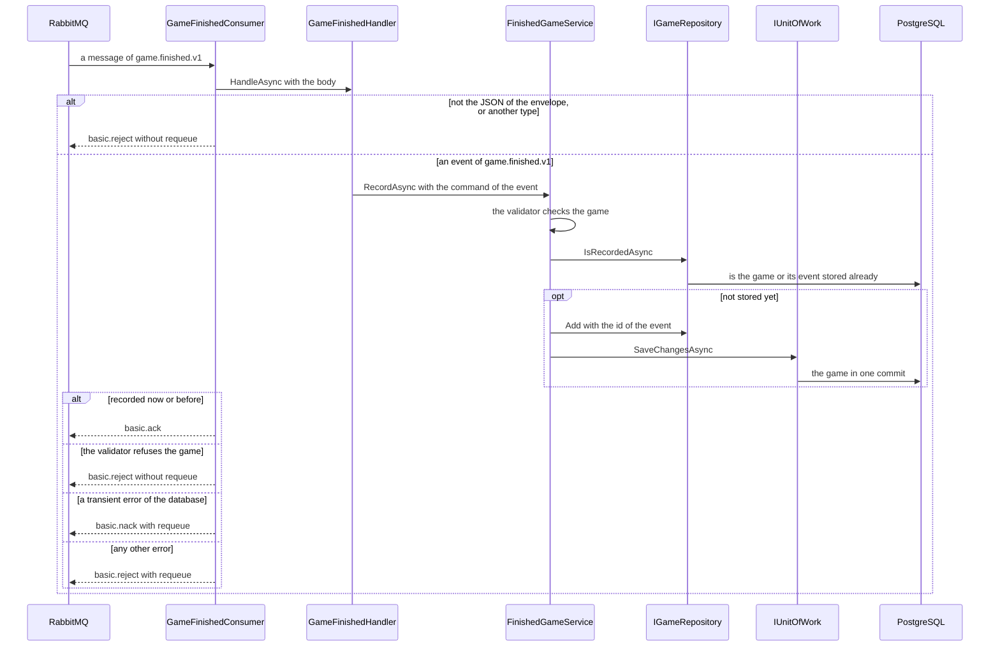

# platform-service architecture

The diagrams of the service at the component level of the C4 model.

## Layers

The arrows are project references, so the compiler checks the dependency rule of [PS-ADR-1](adr/clean-architecture.md). The dashed arrows are the connections to PostgreSQL of [PS-ADR-7](adr/persistence.md) and to RabbitMQ of [PS-ADR-14](adr/messaging.md). The health probe of [PS-ADR-9](adr/container-image.md) is outside the layers and references no project. It asks the readiness endpoint over HTTP.

## Middleware

The middleware of [`Program.cs`](../src/PlatformService.Api/Program.cs) in the order that [PS-ADR-3](adr/request-pipeline.md) decides.

## Reading the current user

How `GET /api/users/me` of [PS-ADR-2](adr/http-api.md) passes the layers, with the authentication of [PS-ADR-4](adr/gateway-authentication.md).

## Registration

How `POST /api/auth/register` of [PS-ADR-2](adr/http-api.md) creates the account of [PS-ADR-11](adr/accounts.md) and its session of [PS-ADR-12](adr/tokens-and-sessions.md), and saves both in the one commit of [PS-ADR-7](adr/persistence.md). Sign-in takes the same path with `FindByCredentialsAsync` instead of `CreateAsync`.

## Refresh

How `POST /api/auth/refresh` of [PS-ADR-2](adr/http-api.md) applies the rotation, the grace window and the reuse detection of [PS-ADR-12](adr/tokens-and-sessions.md), and how the concurrency token of [PS-ADR-7](adr/persistence.md) lets only one of two parallel refreshes replace the token. Logout takes the same path up to the session, revokes it and answers 204.

## Game history

How `GET /api/games` of [PS-ADR-13](adr/game-history.md) lists the games of the signed-in user. `GET /api/games/{gameId}` takes the same path with `GetAsync` and `FindAsync`, and it answers 404 for a game that does not exist and for a game that the user did not play.

## Queues of the finished games

The exchanges and the queues of [PS-ADR-14](adr/messaging.md) in RabbitMQ. The game-service declares `game.events`, and the service declares the rest. The policy of the infra repo, which ADR-6 decides, adds the dead-letter exchange, the delivery limit and the delayed retry to `platform.game-finished`.

## Recording a finished game

How the consumer of [PS-ADR-14](adr/messaging.md) records a game through the use case of [PS-ADR-13](adr/game-history.md), and how it answers the broker. The answer follows the commit, so a game is acknowledged only once it is stored.

